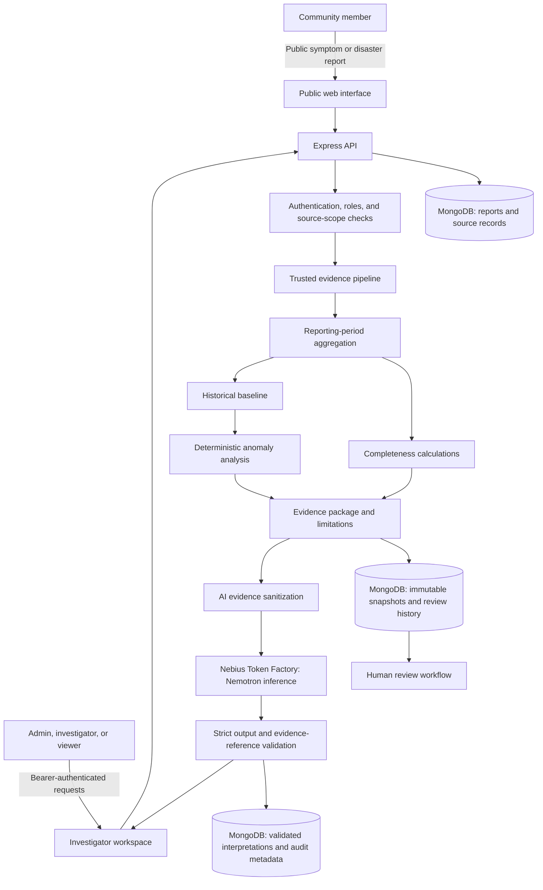

# ResQNet

ResQNet (with its investigator workspace branded **NULL SIGNAL**) is a
community health and disaster reporting prototype. It accepts public
observations and gives authorized investigators tools to review
source-attributed reporting continuity, preserve evidence, and record
human-led follow-up. It is not a medical service, emergency dispatch system,
or certified outbreak-detection product.

## Project overview

### Problem statement

During a public-health or local emergency, community observations and
institutional reports can be fragmented across channels. A sudden change in
the number of reports may be important, but it can also reflect a broken
channel, delayed reporting, incomplete coverage, a schedule change, or missing
data. Treating missing reports as proof that an event has ended—or as proof of
an outbreak—can mislead people making decisions.

ResQNet explores a safer workflow: collect observations, distinguish trusted
source-attributed reports from general public submissions, calculate
reporting-period completeness and historical context, preserve the resulting
evidence, and support a human reviewer in documenting what should be checked
next. The system is designed to describe the reporting signal, not to infer
clinical reality from it.

### Goals and intended users

- **Community members** can submit symptom or disaster observations through
  public forms.
- **Administrators** can manage investigator accounts and source access.
- **Investigators** can inspect the reporting sources they are authorized to
  review, preview evidence, create investigation records, add notes, record
  assessments, and progress cases through a controlled review workflow.
- **Viewers** can read authorized reporting and investigation records without
  changing them.
- **Optional AI assistance** can summarize sanitized evidence and suggest
  verification questions. Its output is advisory and displayed only after
  server-side schema and evidence-reference validation.

The project is most useful today as a prototype, testbed, or starting point for
partner-led evaluation. It does not currently have a live institutional
reporting network or a live incident map.

### Architecture



The public website is served as static files by the same Express application.
Public report submission is separate from authenticated investigator
workflows. Investigator access uses expiring bearer tokens, server-side role
checks, and source-scoped authorization. The deterministic pipeline builds
evidence from trusted, attributed data; investigation records preserve a
snapshot so a reviewer can later see what evidence was reviewed. Review
decisions are appended separately rather than blended into calculated
findings.

AI interpretation is an optional branch after evidence generation. The server
sanitizes and hashes the input, sends it to Nebius only on an explicit
investigator request, validates the returned structure and references, and
persists only validated output with operational audit metadata. Provider
responses are not treated as authoritative evidence.

### Technology stack

| Area | Technologies |
| --- | --- |
| Public website | HTML, CSS, vanilla JavaScript |
| Investigator interface | HTML, CSS, ES modules, browser Fetch API, session storage |
| Backend | Node.js, Express |
| Persistence | MongoDB with Mongoose models |
| Authentication | Node.js cryptography (`scrypt` password hashing, random bearer tokens, SHA-256 token hashes) |
| Mapping | Leaflet with OpenStreetMap/CARTO base tiles; current sample points are illustrative, not live reports |
| AI integration | Nebius Token Factory API with a configured NVIDIA Nemotron model |
| Configuration | Environment variables loaded from an ignored local `.env` file |
| Automated tests | Node.js built-in test runner (`node --test`) |

### Real-world usefulness and boundaries

If deployed with verified partner organizations and reliable reporting
integrations, ResQNet could help teams:

1. Notice that an expected reporting channel has gone quiet or become
   incomplete.
2. Compare current reporting with bounded historical periods, while honoring
   source schedules and local time zones.
3. Keep source facts, calculated indicators, uncertainties, and human
   assessments distinct.
4. Preserve an investigation snapshot and an append-only application-level
   review trail for handoffs and follow-up.
5. Generate optional, constrained summaries and questions that may help a
   reviewer plan verification work.

These are potential uses, not claims that the current project detects
outbreaks or reaches emergency responders. A reporting gap is evidence about
the reporting process; by itself, it does not establish a change in cases,
incidence, safety, or public-health activity. The public map contains no live
incident data. The SOS screen is explicitly a demonstration and does not
contact emergency services. Reports do not connect a user with a doctor or
guarantee review or response.

Before operational use, the project would need participating institutions,
verified source onboarding, real source-data integrations, privacy and
retention policies, clinical/public-health governance, accessibility and
language review, a staffed response process, tested security controls, and
reliable monitoring and incident management.

### Characteristics

- **Evidence-first and deterministic:** completeness, historical baselines,
  and anomaly classifications are calculated by backend services before any
  AI request.
- **Explicit about uncertainty:** unavailable values remain unavailable;
  insufficient history and unknown channel status are not silently converted
  into reassuring conclusions.
- **Source-scoped:** authenticated investigators and viewers see only
  authorized source data; administrator access is separate.
- **Human-in-the-loop:** notes, status transitions, and decisions are
  investigator actions, not automatic conclusions.
- **Auditable by application design:** evidence snapshots and review history
  are immutable through normal application routes, with server-assigned
  reviewer identity and timestamps. This is not tamper-proof storage against a
  database administrator.
- **Optional, bounded AI:** sanitized input, strict output validation,
  constrained evidence references, and explicit generation help limit
  unsupported claims; validation cannot guarantee that a model's validly
  shaped interpretation is substantively correct.
- **Separated user flows:** public reporting remains distinct from protected
  investigation and evidence review.

### Main challenges

1. **Trust and provenance:** public submissions are not equivalent to
   institutionally verified source reports. The system keeps a separate,
   server-controlled attribution path and does not treat account roles as
   proof of institutional identity.
2. **Missingness versus zero:** a completed trusted query returning no reports
   differs from an unavailable or incomplete query. Period aggregation must
   preserve that distinction.
3. **Time and reporting schedules:** daily or weekly windows depend on source
   frequency, local time zone, and aligned period boundaries; incorrect
   boundaries can distort completeness and historical comparisons.
4. **Small or changing baselines:** sparse, seasonal, or changing data can
   make anomaly comparisons unreliable. The pipeline represents insufficient
   history and excludes incomplete periods rather than inventing a baseline.
5. **AI reliability and cost:** provider output can be malformed,
   unsupported, or inconsistent with the evidence; inference also requires
   external network access, configured credentials, and may consume credits.
   Strict validation can reject output but cannot make the model infallible.
6. **Security and operations:** account recovery, shared rate limiting,
   deployment secrets, backups, audit retention, monitoring, HTTPS, and
   institutional onboarding need production-grade operational controls.
7. **Frontend/backend coverage:** the interface is limited to APIs the backend
   actually exposes. For example, it does not invent investigator lists for
   assignment or display fabricated live map incidents.
8. **Safe communication:** health and emergency interfaces must avoid implying
   clinical advice, dispatch, a guaranteed response, or certainty unsupported
   by data.

## Local development and tests

Use Node.js and MongoDB. Configure a local `.env` using `.env.example`, then
start the application with:

```sh
npm install
npm start
```

Create the initial administrator only when the configured database has no
investigator accounts. Set `BOOTSTRAP_ADMIN_NAME`, `BOOTSTRAP_ADMIN_EMAIL`,
and a unique `BOOTSTRAP_ADMIN_PASSWORD` of at least 12 characters in a
protected environment, then run `npm run bootstrap-admin`. Remove those
bootstrap values afterward. Never commit `.env` or use production credentials
for local testing. Detailed authentication and bootstrap constraints are
described below.

Run the automated suite with:

```sh
npm test
```

Live provider smoke tests (`npm run test:nebius:live` and
`npm run test:ai:live`) make external requests and require configured
credentials; they are not necessary for the unit test suite.

## Project documentation

The [investigator frontend guide](./docs/investigator-frontend.md) describes
the connected API contracts, session behavior, and backend capability gaps.
The sections below document data provenance, evidence generation,
authentication, investigation history, and human review in more detail.

## Trusted reporting-source attribution

Investigator authentication and administrator authorization are implemented,
but source credential provisioning and authenticated source ingestion are not
exposed as HTTP endpoints. `services/sourceAttribution.js` provides an internal
service boundary for provisioning, revoking, authenticating, auditing, and
querying source-attributed reports. Its provisioning method is only
appropriate for a trusted server-side operator process; it must not be wired to
a public route until a controlled source-onboarding process exists.

Source credentials are generated from cryptographically secure random bytes.
Only a SHA-256 hash of the high-entropy secret is stored, and the raw credential
is returned once by the internal provisioning method. Successful attribution
requires both an authenticated, active credential and a source that is active
and within its configured validity period. Successful and rejected decisions
are recorded in `ReportAttribution`; trusted report lookup requires a successful
audit record as well as server-assigned `sourceId` and `sourceChannel` fields.
The ordinary public report endpoint remains unauthenticated and cannot assign
these fields.

This mechanism does not establish a facility's legal identity or institutional
authorization. Controlled facility onboarding, secure operator authentication,
credential delivery, rotation procedures, and operational incident response
remain prerequisites before it can be enabled for real sources.

## Historical reporting-period aggregation

`services/reportingPeriodAggregation.js` creates bounded daily or weekly
observations using the source's configured frequency, timezone, expected count,
validity window, and the same local-time boundary helpers as the current
completeness calculation. Range arguments are half-open UTC timestamps that
must align with local reporting-period boundaries. Daily ranges are capped at
366 periods and weekly ranges at 104 periods.

The aggregator calls the server-controlled `getTrustedReports` lookup with the
requested period window. Empty periods are emitted as zero only after that
lookup confirms a completed source-specific query and its window coverage.
Reports are assigned by the server-generated `Report.submittedAt` timestamp;
the accepted attribution audit timestamp is retained as provenance and must
also be valid and no later than evaluation. Client-provided `reportedAt` is an
event time and does not determine the reporting period. Reports are deduplicated
by database ID, not by their content.

Each observation contains the historical-baseline fields and current-period
fields consumed by the existing anomaly/completeness calculations. Its
`isTrusted` flag means only that aggregation ran over a configured source and a
completed, audit-backed server query; it is not legal or institutional
verification. Channel availability defaults to `unknown` and can only be
overridden per period by an explicit trusted caller. In-progress periods remain
in progress and are excluded by the baseline calculator. This service does not
create an API endpoint, write database records, or analyze real historical data
until trusted source reports actually exist.

## End-to-end evidence pipeline

`services/evidencePipeline.js` exposes `generateEvidenceForSource` for a
configured source code, a local-period-aligned `historyStart`, an evaluation
timestamp, and optional trusted per-period channel-availability data. It
resolves the source server-side and runs the trusted lookup, bounded period
aggregation, current-period completeness calculation, eligible historical
baseline, deterministic anomaly detection, and evidence-package builder in
sequence. It does not create an endpoint or write reports.

The current period is evaluated separately and never enters its own baseline.
Only completed, trusted historical observations are passed to the baseline
service; that service retains its minimum-history and unavailable-channel
rules. Successful empty trusted queries remain zero-report observations, while
failed or incompletely covered queries stop the pipeline with a stage-specific
error. `EvidencePipelineError.code` identifies the failed stage, and the
original cause is retained where available. Pipeline findings describe
reporting patterns only; they do not establish symptom prevalence, causation,
or real-world reporting behavior without validated trusted records.

## Investigator authentication and evidence access

Investigator accounts are separate from source-ingestion credentials. Passwords
are stored as salted Node.js `scrypt` hashes; the API issues random opaque
bearer tokens and stores only their SHA-256 hashes in revocable sessions. Tokens
expire after eight hours. Login uses a per-process IP rate limit; requests use
the `Authorization: Bearer <token>` header, not cookies, so this API does not
use cookie sessions or require cookie-based CSRF tokens.

For local setup, copy `.env.example` to the ignored `.env` file and configure
the MongoDB URI and bootstrap values there. Never commit `.env`.
Create the initial administrator only from a controlled machine after setting
`BOOTSTRAP_ADMIN_NAME`, `BOOTSTRAP_ADMIN_EMAIL`, and a unique
`BOOTSTRAP_ADMIN_PASSWORD` of at least 12 characters in a protected local
environment. Then run `npm run bootstrap-admin`. The command refuses to run
after any investigator account exists and claims a unique database bootstrap
record before creating the account, preventing concurrent/repeated bootstrap.
If the process fails after claiming that record, stop and resolve it through a
controlled database administration procedure; do not expose a reset endpoint.
Do not commit these values or put them in shell history; remove the bootstrap
variables after initialization.
Administrators can create accounts and assign configured source codes. Admins
can inspect any configured source; investigators and viewers can inspect only
their assigned sources. Deactivation revokes sessions. No public registration
or source-credential provisioning endpoint is provided.

The read-only evidence endpoint is
`GET /api/investigations/:sourceCode/evidence`, with optional `evaluatedAt`
(UTC ISO timestamp, not in the future) and `periods` query parameters.
Historical periods default to 30 daily or 12 weekly periods and are capped at
365 daily or 103 weekly periods, leaving room for the current period within the
aggregation service's bound. Evidence generation still uses the trusted
attribution-backed pipeline. Investigation requests record the investigator,
source code, timestamps, outcome, safe error code, and request identifier.
Audit persistence is fail-closed: evidence is not returned if the audit write
fails. The legacy all-source completeness route now requires authentication
and limits results to the caller's authorized sources; raw report reads and
legacy evidence routes are admin-only.

This is not a production security certification. Login rate limits are
in-memory and per-process, so deployment needs a shared rate limiter, correctly
configured proxy/network boundaries, HTTPS, secret management, backups,
account recovery, audit retention controls, and verified institutional
identity/onboarding procedures. Never treat account role assignment as proof
of a person's institutional identity or a report's source attribution.

## Investigation history and human review

`POST /api/investigations/:sourceCode` generates evidence through the existing
deterministic pipeline and persists a new `evidence_review` investigation with
a unique `inv_<32 lowercase hex characters>` public ID, source/creator
references, exact evaluation time, requested period count, initial `generated`
status, and a sanitized snapshot of the complete evidence package. Its optional
JSON body accepts only `evaluatedAt` and integer `periods`. The existing
`GET /api/investigations/:sourceCode/evidence` remains a read-only preview; it
does not create an investigation.

The history endpoints are `GET /api/investigations`,
`GET /api/investigations/:investigationId`, and
`GET /api/investigations/:investigationId/reviews`. Authenticated investigators
and viewers can list and read records only for their assigned sources. Listing
supports bounded `page`, `limit`, `sourceCode`, `status`, `createdBy`,
`assignedTo`, and `sort=asc|desc` filters. Details include the immutable
evidence snapshot and up to 100 most recent review records in chronological
order. Review-history pagination supports bounded `page` and `limit`. Public
investigation IDs are distinct from MongoDB document IDs.

Investigators can append notes through
`POST /api/investigations/:investigationId/notes`, record investigator-assessed
decisions through `POST /api/investigations/:investigationId/decision`, and
change status through `PATCH /api/investigations/:investigationId/status`.
Allowed status transitions are `generated -> under_review`,
`under_review -> requires_more_information` or `reviewed`,
`requires_more_information -> under_review`, and `reviewed -> closed`.
Closed investigations cannot be reopened through this API. Admins can assign
or unassign through `PATCH /api/investigations/:investigationId/assignment`,
only to an active investigator who already has access to that source. Viewers
are read-only. Reviewer identity and timestamps are always assigned by the
server, and decisions are stored as review history rather than mixed into
calculated findings.

Evidence snapshots and review records are immutable through the Mongoose model
and application routes provide no update/delete operations for review history.
Creation writes the investigation and its initial review record sequentially;
if a later write or required investigation audit fails, the route attempts a
compensating deletion and returns an error rather than success. This is not a
MongoDB transaction: a process crash between writes or a failed compensation
can leave incomplete records and requires operational reconciliation. Direct
database administrators can still bypass application-level immutability.
Review records are append-only for API purposes, not a tamper-proof legal
record. No real reporting-source investigations are implied by this workflow.
